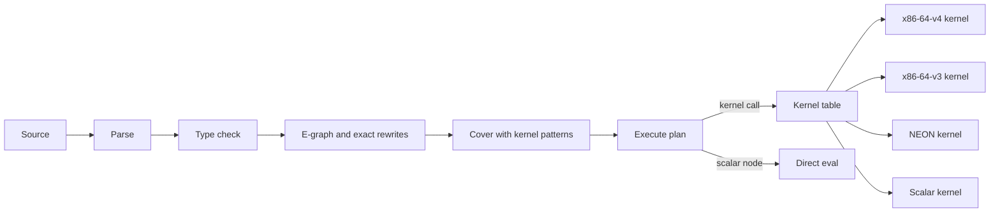

# Verkehrt: design

## Intent

Verkehrt is an interpreted array language built backwards from the machine.
Instead of compiling arbitrary programs and hoping for good code, it offers only primitives that are known to map onto good SIMD instruction sequences on x86-64 and aarch64.
Each primitive is a hand-written kernel, and the interpreter's only job is cheap dispatch between kernels, amortized over enough data that dispatch cost disappears.
The primitive set is the object of study: it maps the space of "things a user can express that run well", and growing it one kernel at a time shows where that space ends.
The problem catalog below drives which primitives exist and in what order.

## Goals

* No machine code emission and no JIT, now or later. Compiling the program to an intermediate representation is allowed, and the first version compiles to a plan: a term graph of kernel calls that the interpreter executes.
* Kernels are patterns: each kernel declares the expression it implements, and the interpreter covers programs with kernels the user never names. Writing `sum(x * y)` runs a fused dot-product kernel, and there is no user-facing `dot`.
* Higher-order functions are the main abstraction mechanism, with no objects, classes, or per-element dynamic dispatch.
* Every primitive has a SIMD kernel for x86-64 (the `x86-64-v3` and `x86-64-v4` levels) and aarch64 (NEON, SVE later), plus a scalar reference kernel.
* Explicit syntax that leaves nothing to interpretation: no precedence table, no implicit conversions, no currying.
* All type errors are reported before any kernel runs.
* The cost of a program is visible: the interpreter can report every kernel call, its ISA variant, element count, bytes moved, and throughput.

## Non-goals

* Generating code for fused expressions. Fusion comes from prebuilt kernels whose patterns match and, later, from executing chains of kernels a tile at a time. Until tiling exists, everything outside a fused kernel runs as one memory pass per primitive, so memory bandwidth is the cost model.
* Fast execution of small arrays. Dispatch dominates there, and that is an accepted, documented limit.
* Object orientation, mutation, and general recursion over elements.
* Multithreading. Verkehrt is single-threaded by design, because the intended long-term host is a dataflow system such as Timely or Differential Dataflow, which supplies parallelism through its workers. Each worker would run its own interpreter instance over its own batches.

## Anti-goals

* A primitive whose kernel is secretly a scalar loop on a supported ISA, unless the catalog documents it as a strain case. That would hide exactly what the language exists to reveal.
* Accepting a program and then running it per element. Anything that cannot be lifted to whole arrays is rejected with an error, not executed slowly.
* Results that differ between ISAs for the same input (see float reductions).

## Execution model

The interpreter parses a program, type-checks it, plans it, then executes the plan.
Planning covers the typed program with kernel patterns (see kernel selection), producing a sequence of kernel calls over whole arrays, and scalar nodes are evaluated directly.
Kernel variants are selected once at startup by runtime CPU feature detection and stored in a function-pointer table.
Dispatch per kernel call is one indirect call, plus, for reductions, one allocation of a boxed reducer and one virtual `update` call per tile.
A command-line flag forces a variant (`--isa scalar|x86-64-v3|x86-64-v4|neon`) to compare implementations on the same program.
`x86-64-v3` and `x86-64-v4` are the psABI microarchitecture levels, so v3 includes AVX2 and v4 adds AVX-512 F, BW, CD, DQ, and VL, all required. Detection picks the best level the CPU fully supports, and `--isa x86-64-v4` fails on a CPU without all of them. A kernel entry that needs a feature beyond its level, such as the byte `compress` with VBMI2, declares it and falls back to the level's `auto` entry where the CPU lacks it (`docs/superpowers/specs/2026-10-31-verkehrt-isa-levels-design.md`).
Each ISA has two backends. The autovectorization backend compiles every kernel's portable body under that ISA's target features and covers every kernel. The intrinsics backend holds hand-written kernels and exists only where one was written. `--backend auto|intrinsics` picks between them (default `intrinsics`, falling back to auto, then scalar), so every hand-written kernel is measured against what the compiler produces from the same semantics.

On aarch64 the auto backend is the baseline build, because NEON is mandatory there and the compiler may vectorize the portable bodies for it. So no `neon/auto` entries exist, the `neon/auto` slot falls back to scalar, and `--isa neon --backend auto` runs the scalar kernels. On the M5 the scalar `sum`, `sum(x * y)`, and `count` run within 1.02x of native loops, while the scalar float `min` and `argmin` run 2.77x to 5.48x slower than native, so those got NEON intrinsics. An auto backend with optional aarch64 features (for example `dotprod`, `fp16`, `rdm`) is a possible later pivot: one invocation of the shared auto macro plus an `is_aarch64_feature_detected!` check.



### Kernel selection

Kernel selection works like equality saturation in reverse.
Normal equality saturation explores equivalent programs and extracts the cheapest one, while here the extraction targets are fixed: a library of kernels, each declaring the pattern it implements in the language's own primitives.
The interpreter builds an e-graph of the program, applies exact rewrites to widen what matches, then covers the e-graph with kernel patterns at minimum cost.
This is instruction selection where the instructions are whole-array kernels. The output is the plan, a term graph whose nodes are kernel calls and whose edges are array values, and no machine code is generated (the plan is the only IR in the first version, my call).

* **Kernel library.** Each kernel has a typed pattern with pattern variables (for example `dot: sum(?x * ?y)` for `f64[]`), a cost function, and one implementation per ISA plus scalar. Every primitive has a single-operation kernel, so a complete cover always exists.
* **Ordering.** Semantics fix as little order as possible, so ordering never blocks an optimization. Output from `print` appears in source order. Pure computation has no defined order and may move, fuse, or be shared across statements, for example a later multi-output kernel that computes `sum(x)` and `max(x)` of two statements in one pass. When a program has a runtime error, which error is reported is unspecified if several would occur, and output printed before the error may be incomplete (my call, following the user's rule that ordering must not become semantics where it would stand in the way of optimizations). The first version still executes statements in source order, as the simplest implementation of these rules.
* **Planning unit.** In `run` mode, a `let` binding with exactly one use is inlined into its consumer before planning, so `let t = x * y; print(sum(t));` matches `dot` across the binding. A binding or repeated subexpression with more than one use is materialized once and becomes a leaf for every consumer (my call). This keeps extraction tree-shaped, which egglog's built-in tree-additive extractor handles correctly, and makes sharing a predictable rule rather than a cost decision. In the REPL, each input is planned on its own and earlier bindings are materialized leaves. User functions are not recursive in the first version and are inlined before planning (my call).
* **Broadcast.** A scalar operand of an array operation appears as an explicit `Broadcast(c)` node. `Broadcast` is never extracted as a kernel and never materializes, and each kernel declares per input whether it takes an array or a broadcast scalar (my call).
* **Exact rewrites only.** A rewrite must preserve every result bit. The first version uses commutativity of `+`, `*`, `min`, `max`, `==`, `!=`, `and`, and `or`, and comparison flipping (`x > c` to `c < x`). Lambdas are already lifted away before the e-graph is built. Float addition and multiplication do not associate or distribute, so those rewrites are excluded for floats. Wrapping integers form a ring, so integer associativity and distributivity are candidates for later.
* **Cost.** Cost is bytes read plus bytes written per element of the statement's input length. Outputs of selection primitives (`compress`, `filter`, `where`) are assumed to be as long as their input, which is conservative (my call).
* **Limits.** Saturation runs with node and iteration limits. When a limit is hit, extraction uses the e-graph as it stands, which is still correct, only possibly less fused.
* **Free test oracle.** A fused kernel's pattern, evaluated through the single-operation scalar kernels, is its reference. Every fused kernel gets a property test that requires bit-identical results against that reference.
* **Visibility.** `--plan` prints the chosen cover for each statement, showing which kernel covered which subexpression.
* **Crate.** The `egglog` crate (3.x) is the default choice, picked over its predecessor `egg` at the user's suggestion. It fits this design: a kernel pattern becomes a rule that unions `(Sum (Mul x y))` with `(Dot x y)`, type conditions become Datalog guards, and each kernel constructor carries its cost. The kernel library's patterns can therefore live in one egglog rule file next to the kernel implementations. If embedding egglog from Rust turns out awkward for typed patterns, the builder may fall back to `egg` and record why.

Fusion is legal only because of the semantics decisions below: with the canonical summation order and no FMA, a fused `dot` computes exactly the same bits as `*` followed by `sum`.
### Tile-at-a-time execution

Executing a chain of kernels over cache-sized tiles (around 1024 rows, as in X100, Polars, and the plan for corgi) is a planned extension, not part of the first version.
Each kernel still runs as written, but over one tile at a time into a reused destination buffer, so intermediates stay in L1 and a chain costs about one memory pass.
It is an execution strategy for the same plan, not code generation, and it complements pattern fusion: fused kernels remove passes where a pattern exists, and tiling shrinks the cost of the passes that remain.
Nothing in the design may prevent it, which fixes these first-version decisions:

* Every kernel declares a class: elementwise (output row `i` depends only on input rows `i`), reduction, selection (data-dependent output length, as in `compress` and `where`), or whole-array (everything else, such as a later `sort`).
* Elementwise kernels are implemented over slices into a caller-provided destination, with the allocating call as a thin wrapper, so the same code runs on a tile.
* Reductions are implemented as state, update, and finish, so a reduction can consume tiles. The canonical float order survives tiling when every tile except the last has a length that is a multiple of 16, because the 16 accumulators are the state and the tail is added at finish.
* Selection kernels append to a growing output, so they also run per tile.
  Each selection counts the survivors of its tile first and reserves the output for them plus one 64-byte vector of room for vector stores, so an array retains about 1x its rows and the input is read twice.
  This was measured against reserving every row, which is faster but retains up to 8x, and against a 2x shrink rule, which copies the output when more than half of the reservation is unused and was slower at 50% selectivity, see `docs/measurements/2026-10-30-x86-kernels.md`. Those measurements reserved one row of room past the survivors, not a vector.
* Array views make a tile of an input a zero-copy slice, and length checks happen before execution, so no error depends on tile boundaries.
* The ordering rules already leave the executor free to interleave statements.

Reporting near misses, such as `sum(cast_f64(x) * y)` almost matching `dot`, is the next step after the first version, because near misses mark the edge of the "good code" map.

### Higher-order functions by lifting

A function passed to a higher-order primitive is never called once per element.
Lifting is a pre-pass after type checking: the interpreter substitutes the lambda's parameter with the argument array, so `|v| (v * 2.0) + 1.0` becomes two array operations, `filter(x, p)` becomes `compress(x, p(x))`, and `if` becomes `select`.
The e-graph only ever sees first-order array terms, because e-graphs do not handle bound variables well (my call).
A lambda body that does not use its parameter, such as `|v| 1.0`, is wrapped in `fill(length(x), body)` so the result is still an array of the argument's length.
This restricts what a lambda body may contain: arithmetic, comparisons, `if` (evaluated as compute-both-and-select with a mask), calls to other liftable functions, and captured scalars, which broadcast.
The type checker rejects lambdas that capture arrays, call non-liftable functions, or recurse, and the error names the offending construct.
Reductions and scans take an operator, not a lambda, because only associative primitive operators (`add`, `mul`, `min`, `max`, `and`, `or`, `xor`) vectorize, and an arbitrary fold function is a documented strain case.

## Language

The syntax is Rust-flavored and explicit.

```
fn dot(x: f64[], y: f64[]) -> f64 {
    sum(x * y)
}

let x: f64[] = load_f64("x.bin");
let y = rand_f64(length(x), 42);
let d = dot(x, y);
let pos = filter(x, |v| v > 0.0);
let n = count(x > 0.0);
let m = reduce(x, max);
let c = map(x, |v| if v > 0.0 { v } else { 0.0 - v });
```

Rules:

* Calls always use parentheses. There is no juxtaposition, currying, or point-free style.
* There are no implicit conversions. `i32 + f64` is a type error, and the user writes `cast_f64(a) + b`.
* There is no operator precedence. Mixing different binary operators without parentheses (`a + b * c`) is a parse error. Chaining the same arithmetic operator (`a + b + c`, `a - b - c`) is allowed and parses left to right as `(a + b) + c`, which matters because float `+` is not associative. Chained comparisons (`a < b < c`) are a parse error (my call).
* Lambdas use `|v| expr`. Parameter types are inferred from the call site.
* Function signatures carry types, and `let` bindings infer them.
* Bindings are immutable and arrays are values.
* Arithmetic operators work on scalar-scalar, array-array, and array-scalar operands, with the scalar broadcast. Array-array operands of different lengths are a runtime error.
* Tuples exist for primitives with several results (joins, group-by) and destructure with `let (a, b) = ...;`.

### Types

* Scalars: `i8`, `i16`, `i32`, `i64`, `u8`, `u16`, `u32`, `u64`, `f32`, `f64`, `bool`.
* Arrays: `T[]` for each scalar type, one-dimensional.
* Tuples of the above.
* Function types for top-level functions and lambdas, used only as arguments to higher-order primitives.
* `f16` and `bf16` are candidates for later. M1 and M5 have native `f16` arithmetic, but the x86 development machine (Zen 5) only converts `f16` (F16C) and only has `bf16` dot products (AVX512_BF16), so they would start as a strain case.

Narrow types are where SIMD gains most: a 512-bit register holds 64 `u8` lanes but only 8 `f64` lanes, and memory traffic shrinks by the same factor.
They also have the most instruction gaps. x86 has no 8-bit multiply or shift, AVX2 has no unsigned compare (it needs a sign-bias trick), and AVX2 has no unsigned to float conversion.

**The kernel table is the type system's source of truth.** A primitive applied to an element type that has no kernel is a type error, reported before execution (for example "no kernel for `*` on `i8[]`"). Each pair either has a kernel on every supported ISA, with emulation recorded in the catalog where needed, or is rejected. This matches the language's premise and bounds the work: adding a type to the language costs nothing, and adding kernels for it grows the set of programs that type-check (my call).

Reductions widen their result: `sum` and `reduce(x, add)` over `i8`, `i16`, `i32` return `i64`, and over `u8`, `u16`, `u32` return `u64`, because a `u8` sum that wraps at 256 is useless and widening sums are cheap in SIMD (`vpsadbw` sums `u8` directly). `f32` sums stay `f32`. Elementwise operations stay in their type and wrap (my call).

`bool[]` uses one byte per element, 0 or 1 (my call, simplest across ISAs). Packed bitmasks are an interesting catalog experiment because AVX-512 and SVE produce them natively, but they complicate NEON and AVX2 kernels.

### Semantics decisions

* Integer arithmetic wraps (two's complement), which matches the SIMD instructions. Checked arithmetic would add a compare and reduce per operation, so it is a candidate primitive, not the default (my call).
* Integer division is not in the first version. x86 has no SIMD integer divide, which makes it exactly the kind of operation the language should exclude until a good kernel exists (division by a constant via multiply-shift is a catalog entry).
* Float reductions use one canonical summation order on every ISA, so every variant, including the scalar kernel, produces bit-identical results (my call). The order is defined as follows:
  * Let `n` be the length and `b = n - (n mod 16)`. Accumulator `j` (0 to 15) starts at `+0.0` and adds elements `j, j + 16, j + 32, ...` below `b` in increasing index order.
  * The accumulators combine pairwise: `acc[j] += acc[j + 8]` for `j < 8`, then `acc[j] += acc[j + 4]` for `j < 4`, then `+ 2`, then `+ 1`.
  * The tail elements `b` to `n - 1` are added to `acc[0]` one at a time in index order.
  * Accumulation happens in the element type, so `f32` sums accumulate in `f32`.
  * Register tiling per ISA is free (4 ymm or 2 zmm for `f64`, 8 NEON registers), as long as it computes exactly this order.
* No kernel uses fused multiply-add. FMA rounds once where the scalar reference rounds twice, which would break bit-identity, so a fused primitive that wants FMA must define its reference with `f64::mul_add` (my call).
* Float `min` and `max` follow IEEE 754-2019 `minimum` and `maximum`: a NaN operand produces NaN, and `-0.0` is less than `+0.0`. `argmin` and `argmax` return the index of the first NaN if any element is NaN, otherwise the first index of the extreme value (my call). x86 `vminpd` does not have these semantics, so kernels need extra compare and blend instructions, and the catalog records that cost.
* Bit-identity applies to every non-NaN result. A NaN result must be NaN in every variant, but sign and payload may differ, because x86 and ARM produce different default NaNs (my call).
* Out-of-bounds gather indices are a runtime error. The bounds check is a vector compare and reduce, which is cheap relative to the gather.
* Casts follow Rust `as` semantics: float to integer truncates toward zero and saturates, NaN becomes 0, and integer to narrower integer wraps. x86 conversion instructions return the "integer indefinite" value instead, so x86 cast kernels need compare and blend fixups, and the catalog records that cost. AVX2 has no `i64` to `f64` conversion in either direction (`vcvtqq2pd` and `vcvttpd2qq` are AVX-512DQ), which makes those casts a documented strain case (my call). The `x86-64-v4` level includes `avx512dq`, and the assembly of its `auto` entries shows `vcvtqq2pd` for `i64` to `f64` (a vector loop, no gain beyond the build-to-build shift seen on unchanged scalar code, so it stays a strain case) and `vcvtuqq2pd` for `u64` to `f64`. `f64` to `i64` and `f64` to `u64` stay a scalar conversion per row at both levels, because the `auto` entries do not emit `vcvttpd2qq` or `vcvttpd2uqq` (strain cases, `docs/measurements/2026-10-31-isa-levels.md`).
* Float `reduce(x, mul)` uses the same canonical order as summation, with accumulators starting at `1.0`.
* `reduce` on an empty array returns the identity for `add`, `mul`, `and`, `or`, and `xor`. `min`, `max`, `argmin`, and `argmax` on an empty array are runtime errors (my call).
* Indices and counts are `i64`: `where`, `argmin`, `argmax`, `count`, and `length` return `i64`, and `gather` takes `i64[]`.
* `rand_i64` and `rand_f64` are counter-based: element `i` is SplitMix64 applied to `seed + i`, and `rand_f64` maps the top 53 bits to `[0, 1)` by multiplying with `2^-53`. That makes every variant bit-identical (my call).
* Integer `abs` and `neg` wrap, so `abs(i64::MIN)` is `i64::MIN`.
* An `if` whose condition is a scalar `bool` is lazy: the condition is evaluated first, then only the taken branch, so `if length(e) > 0 { reduce(e, max) } else { 0.0 }` is safe on an empty `e`. An `if` whose condition is `bool[]`, which includes every `if` inside a lifted lambda whose condition depends on the parameter, computes both branches and selects per element. Each branch of a lazy `if` is planned on its own, so fusion applies inside branches, and work is never hoisted out of a branch into unconditional code.

## Scope of the first version

The first version implements kernels for `f64`, `f32`, `i64`, `u64`, `i32`, `u8`, and `bool`, where `u64` came with tier 2. The other scalar types type-check, but every primitive on them is rejected for lack of a kernel until kernels exist.
The scalar, `x86-64-v3`, and `x86-64-v4` variants gate the first version. NEON kernels are part of the first version but come as the last batch and do not gate it.

## Extension: byte strings

Byte strings are a planned extension, not part of the first version. A string array is ragged, so it does not fit the one-dimensional `T[]` model directly.
The intended representation is offsets plus data: a `bytes[]` value is an integer array of offsets plus one `u8[]` of concatenated data, and per-string operations (length, equality, prefix tests, hashing) become segmented primitives over the data buffer.
Whether the exact layout follows Arrow or the `columnar` crate is deferred. `columnar` is attractive because it is the direction of the Timely and Differential ecosystem, the intended host, so values could pass between host and interpreter without conversion.
Three first-version decisions keep that path open at no extra cost:

* An array value is a view (shared buffer, offset, length), not a whole buffer. Slicing and substrings are then zero-copy, which also suits batches handed in by a host such as Timely.
* The type checker and the kernel table are keyed by value type, not only by scalar element type, so a composite type backed by several buffers can be added without changing the dispatch model.
* String literals (`"..."`) already exist for file paths. A later byte-string type reuses that literal syntax, and `b"..."` is reserved.

Two parts of the design will need extending when strings arrive. Lifting currently assumes a lambda's parameter is a scalar element, and for strings the element is a segment. The cost model counts bytes per element of one input length, and strings have two lengths, so costs must become functions of the string count and the byte count.

## Primitives for the first version

| Group | Primitives |
|---|---|
| Elementwise arithmetic | `+ - *`, `/` (floats only), `neg`, `abs`, `min`, `max`, `sqrt` (floats) |
| Comparison and logic | `== != < <= > >=`, `and`, `or`, `not`, `if` as select |
| Conversion | `cast_<type>` for every scalar type |
| Reduction | `reduce(x, op)`, `sum`, `count`, `any`, `all`, `argmin`, `argmax` |
| Selection | `filter(x, pred)`, `compress(x, mask)`, `where(mask)` (indices of true elements) |
| Higher-order | `map(x, f)`, `zip_map(x, y, f)` |
| Construction | literals `[1.0, 2.0]`, `iota(n)`, `fill(n, v)`, `rand_i64(n, seed)`, `rand_f64(n, seed)` |
| Input and output | `load_<type>(path)` (raw little-endian binary), `print(v)`, `length(x)` |

## Problem catalog

Tier 1 is the first version, matching the stated first workload (sums, dot products, filters).
Later tiers extend the primitive set, and each entry records where the model strains.

### Tier 1: reductions and filters

| Problem | Primitives | x86-64 | aarch64 | Notes |
|---|---|---|---|---|
| Sum | `reduce(add)` | `vaddpd`/`vpaddq`, multiple accumulators | `fadd`/`add` on `v` registers | Canonical float order above. Memory-bound at large sizes. |
| Dot product | fused kernel for `sum(?x * ?y)` | `vmulpd`, `vaddpd` | `fmul`, `fadd` | No FMA (see semantics decisions). Unfused, this is two passes and a temporary array, 2x the memory traffic by the cost model and about 2.5x counting read-for-ownership of the temporary. The first test of pattern-based fusion. |
| Sum of squares | fused kernel for `sum(?x * ?x)` | `vmulpd`, `vaddpd` | `fmul`, `fadd` | Matches `dot` with `x = y` too, but reads `x` once instead of twice. Tests that the cost model prefers the narrower kernel. |
| i64 multiply | `*` on `i64[]` | `vpmullq` needs AVX-512DQ, which `x86-64-v4` includes, so its `auto` entry runs `vpmullq` on `zmm`, 32 rows per iteration. The `x86-64-v3` entry runs three `vpmuludq` plus shifts and adds on `ymm` | NEON has no `.2D` multiply, same emulation | Strain case: a tier 1 primitive with no native instruction at `x86-64-v3` or on NEON. The `x86-64-v4` entry uses `vpmullq` with no measured gain, because the kernel is memory-bound at 10M rows (`docs/measurements/2026-10-31-isa-levels.md`). |
| Count matching | fused kernel for `count(?x > ?c)` and other comparisons | compare into mask, then `kmov` plus scalar `popcnt` (AVX-512) or mask add (AVX2) | `fcmgt`, `sub` of mask | Avoids materializing the `bool[]`. |
| Filter by comparison | fused kernel for `compress(?x, ?x > ?c)` | compare plus `vpcompressq` | compare plus `tbl` | The common case of `filter(x, \|v\| v > c)` after lambda inlining. |
| Min, max | `reduce(min/max)` | `vminpd` plus NaN and signed-zero fixup, `vpminsq` (AVX-512) | `fmin`, `smin` | `vpminsq` for i64 does not exist in AVX2, so it needs compare plus blend. NaN semantics are under semantics decisions. |
| Argmin, argmax | `argmin` | compare, blend index vectors | `fcmgt`, `bsl` | Tie rule: first index wins. |
| Count, any, all | `count`, `any`, `all` | `vpsadbw` on byte masks, `vptest` | `addv`, `umaxv` | Byte masks make counting cheap. |
| Filter | `filter`, `compress` | `vpcompressq`, `vpcompressb` (VBMI2), AVX2 needs a permute lookup table | NEON has no compress, needs `tbl` lookup, SVE has `compact` | First real strain case. Output length is data-dependent. |
| Where | `where` | compress of an `iota` vector | same as filter | Index vectors feed tier 2. |
| Clamp, abs | `max`, `min`, `abs` | `vmaxpd`, `vandpd` sign mask | `fmax`, `fabs` | Lambda lifting test. |
| Conditional sum | fused kernel for `sum(map(x, \|v\| if v > t { v } else { 0.0 }))` | compare plus masked add | `fcmgt`, `and` | Three passes unfused. Tests matching through lambda inlining and `if`. |

### Tier 2: scans, gathers, and grouping

Plan 4 implemented the rows below, and `docs/measurements/2026-10-31-tier2.md` has the numbers behind every verdict.
"Strain case" marks a kernel that is a scalar loop on that ISA after measurement, which the anti-goals allow only with a catalog entry.
The aarch64 column names the NEON situation where it is known, such as `gather` having no instruction, and otherwise says the kernel runs its scalar entry, which the baseline build compiles for NEON. The NEON measurements follow from the M5 session.

| Problem | Primitives | x86-64 | aarch64 | Notes |
|---|---|---|---|---|
| Prefix sum, running max | `scan(x, op)` | Scalar loop at `x86-64-v3` and `x86-64-v4`, for integers and for floats with `min` and `max` (strain case). | Scalar entry | Integer types with every integer `reduce` operator, and floats with `min` and `max`. The in-register log-step prototype gained 3% at 10M rows, and the scan is memory-bound, so it has no intrinsics. |
| Segmented scan | `scan_by(x, starts, op)` | `x86-64-v4`: segmented log-step, with the start flags in a mask register (`vptestmb`, `valignq`, masked `vpaddq`), `add` on `i64` and `u64` only. `x86-64-v3`: scalar loop (strain case). | Scalar entry | 0.81 of scalar at `x86-64-v4`. `x86-64-v3` needs `vpermq` plus a blend and `vperm2i128` for the lane shifts and ran at the scalar loop's speed. Splitting the scalar loop that `scan` and `scan_by` share into one loop with `starts` and one without measured within noise in the review of #6: three back-to-back rounds at load 4 to 11, every `scan-add-i64` and `scan-by-add-i64` variant within run-to-run spread, for example `scan-add-i64/scalar` at 7.8 to 7.9 ms before and 7.4 to 7.95 ms after. The raw output was not kept. The limit is attributed to the loop-carried dependency on the previous row. The other folds and the 32-bit and 8-bit types are scalar loops on both ISAs, because they were not prototyped. |
| Previous element | `prev(x, fill)` | A `memcpy` plus the fill row, vectorized by libc | Same | Not an intrinsics candidate. |
| Gather | `gather(xs, idx)` | `vpgatherqq` on `ymm` (`x86-64-v3`) and `zmm` (`x86-64-v4`) for 64-bit rows, after a vectorized bounds pass. 32-bit, `u8`, and bool rows keep the `auto` entry, whose row loop is scalar behind the vectorized bounds pass (strain case, although `vpgatherdd` and `vpgatherdq` exist, and they were not prototyped). | No gather instruction (strain case, scalar entry). | 0.80 and 0.83 of scalar, within 1.04x of the native gather loop. Slower than the scalar loop on mid-sized sources: 1.05x and 1.18x for a 512 KB source in a standalone prototype. |
| Histogram | `histogram(keys, n)` | Vectorized bounds pass, scalar bucket loop (strain case). | Scalar entry | `vpconflictq` and 8 replicated sub-histograms with gather and scatter were prototyped and lost by 1.5x to 1.9x on uniform keys. 1.72x of native, with a single-pass bounds check as the known improvement. |
| Bucketed reduction | `reduce_into(keys, vals, n, op)` | Vectorized bounds pass, scalar bucket loop (strain case). | Scalar entry | 1.94x of native, with the same single-pass improvement. `histogram` is `reduce_into` with a fill of 1, and the planner does not yet cover that form with `histogram`. |
| Division by constant | `div_const(x, c)` | `ymm` or `zmm` shifts and sign fix, with a scalar `mul` per lane for the 64-bit multiply-high (strain case on `i64` and `u64`). | Scalar entry | Neither `x86-64-v3` nor `x86-64-v4` has a 64-bit multiply-high. `i64` runs at 0.65 of scalar and 0.85 of the native loop, and `u64` runs at the scalar entry's speed. |
| Sort | `argsort(x)` | Scalar sort, stable through an index tiebreak, with only the index initialization compiled for the ISA (strain case). | Scalar entry | 0.10 GB/s at 10M rows. Tier 3 replaces it with sorting networks or a radix sort built from `histogram` and `scatter`. |
| Bitwise | `and`, `or`, `xor`, `not` on `i64`, `u64`, `i32`, `u8` | `ymm` and `zmm` loops | Scalar entry | Measured at 10M rows on `i64`: `and` and `xor` ran at the bandwidth of `add` (17.29 and 17.54 GB/s against 17.44), `not` ran at 0.67 of `add`'s bandwidth with one input array against two, and `or` was not benched. `or` is inferred to match `and` and `xor`, because its body has the same shape. `xor` also covers `bool`, and the integer `reduce`, `scan`, `scan_by`, and `reduce_into` take `and`, `or`, and `xor`. |
| Slice | `slice(x, start, end)` | A view, no kernel | Same | Invalid bounds are a runtime error. |
| Group-by on sorted keys | `scan_by`, `prev`, `compress` | Run starts from `prev` and a compare, `scan_by`, then `compress` on the run ends | Same | No primitive of its own, and `tests/programs/group_sorted.vk` shows it. |
| `u64` compare and cast | `<`, `<=`, `>`, `>=`, `cast_u64_*`, `cast_*_u64` | `x86-64-v3` has no unsigned 64-bit compare, so it flips the sign bit of both operands and uses the signed compare. `x86-64-v4` has `vpcmpuq` (AVX-512F). The `x86-64-v4` `auto` entry for `u64` to `f64` uses `vcvtuqq2pd` (AVX-512DQ), while the `x86-64-v3` entry vectorizes it with a magic-constant split (`ymm`). `f64` to `u64` is a scalar conversion per row at both levels (strain case, `vcvttsd2usi` in its scalar form at `x86-64-v4`). | Scalar entry | The compare timings were not measured. The `u64` to `f64` cast at `x86-64-v4` is within the run-to-run spread of the scalar entry. The assembly verdicts and cast timings are in `docs/measurements/2026-10-31-isa-levels.md`. |

Not implemented: `scatter`, which tier 3 needs for radix sort.

#### Surface gaps

A primitive should accept every operator and element type that has an ISA-independent result, so these holes are listed in one place and the tier 2 design's "Deferred: surface gaps" section has the candidate designs.

* Float `add` and `mul` in `scan`, `scan_by`, and `reduce_into`. They need a canonical order that every ISA computes, and today they are rejected with the "no kernel" type error.
* Float element types in `argsort`, which need a total order for NaN and the two zeros.
* The `bool` element type in `argsort`. It has a defined total order, so a kernel would be well defined, and plan 4 left it out for scope.
* `reverse`, `rotate`, and packed bitmasks (`bool[]` as bits).
* The `histogram` pattern for `reduce_into` with a fill of 1, which the planner does not cover with `histogram` yet. Covering it needs a constant relation in the egglog prelude.
* `neg` and `abs` on unsigned types. They have no kernels by design, like `u8`, because they are registered only for signed types (a wrapping `neg` for unsigned types is one added kernel if wanted).

### Tier 3: sorting and joins

| Problem | Primitives needed | Notes |
|---|---|---|
| Sort | `sort`, `argsort` | Sorting networks in registers plus merge, or LSD radix sort built from histogram and scatter. |
| Group-by on unsorted keys | `argsort` then tier 2, or `hash_group` | Compare sort-based and hash-based, the classic database question. |
| Hash join | `hash`, `hash_build`, `hash_probe` | Build is scatter with conflicts, probe is gather plus compare. Returns `(i64[], i64[])` index pairs. |
| Sort-merge join | `argsort`, `merge_join` | Merge step is data-dependent, a likely strain case. |
| Semi-join, anti-join | `member(keys, set)` | Reduces to a filter with a probe mask. |
| Distinct | `sort` plus neighbour compare, or hash | |
| Top-k | `top_k(x, k)` | Partial sort or threshold filter. |

### Tier 4: bytes and strings

| Problem | Primitives needed | Notes |
|---|---|---|
| Byte search | `find_byte` | `vpcmpeqb` plus `vpmovmskb`, NEON `cmeq` plus `shrn` trick. |
| Split on delimiter | `where(bytes == c)` | Needs a `u8[]` type. |
| Parse integers | `parse_i64` | simdjson-style digit validation and multiply-add. |
| UTF-8 validation | `utf8_valid` | Lookup-table approach. |

### Strain cases to document, not hide

* Arbitrary fold functions (non-associative or user-defined).
* Data-dependent iteration counts per element, such as a `while` loop or Collatz steps.
* Small arrays, where dispatch dominates. Measure the crossover length per primitive.
* Long chains of elementwise operations, where unfused passes multiply memory traffic.
* Nested arrays and ragged data.
* Tier 2 kernels that are scalar loops on a supported ISA after measurement: `histogram` and `reduce_into` bucket loops, `div_const` on 64-bit types, `scan` on integers and on floats with `min` and `max`, `scan_by` at `x86-64-v3` (and every fold but `add` on both x86 levels), `argsort`, `gather` on 32-bit, `u8`, and bool rows on x86 and every `gather` on NEON, and the `i64` to `f64`, `f64` to `i64`, and `f64` to `u64` casts on x86 (the `i64` to `f64` cast has a `vcvtqq2pd` vector loop at `x86-64-v4` with no measured gain). The tier 2 catalog gives the measurement behind each.

## Observability

Making cost visible is a goal, not a debugging aid.
`--trace` prints one line per kernel call with the primitive, chosen variant, element count, bytes read and written, wall time, and effective GB/s.
`--stats` prints totals per primitive at exit.
These outputs answer whether a given program runs well and why, which is the question the language exists to explore.

## Implementation constraints

* Implementation in Rust, using `std::arch` intrinsics with runtime feature detection (`is_x86_feature_detected!`, `is_aarch64_feature_detected!`). Unsafe is limited to kernels, and each unsafe block carries a SAFETY comment stating which CPU feature and alignment assumptions it relies on.
* Arrays are atomically reference-counted (`Arc`), immutable, 64-byte aligned buffers. A kernel may write its output into an input buffer that nothing else references (reference count 1), and otherwise allocates (my call). Programs cannot observe the difference.
* The development machine is x86-64 with AVX2, AVX-512F/BW/CD/DQ/VL, and VBMI2, so the `x86-64-v3`, `x86-64-v4`, and scalar variants can be tested natively.
* NEON kernels ship in the first version. The code must build on macOS as well as Linux (`aarch64-apple-darwin`). Correctness is verified in CI: the test workflow runs on GitHub's `macos-latest` runners, which are Apple Silicon, so every push runs the NEON kernels' bit-identity tests against the scalar reference. Benchmarks need quiet hardware and run on the user's Apple M1 and M5 machines. Those are not reachable over SSH: the user checks out the repository on a Mac and starts a separate agent session there, so benchmark work must be planned as self-contained batches with a written hand-off (branch, commands to run, expected results) that a session on the Mac can execute without this conversation's context.
* SVE is deferred. Apple Silicon does not implement SVE (M4 and later have SME, whose streaming mode is a separate programming model), so SVE kernels need other hardware or an emulator before they can be tested.
* Each kernel is tested against the scalar reference kernel with property tests that cover lengths 0 to a few hundred (tails), misaligned slices, and special float values. Results must be bit-identical.
* SIMD kernels start as portable Rust compiled once per ISA (for example through `#[target_feature]` copies) and measured. Hand-written intrinsics replace a kernel only where measurement shows a gap against the baseline. Corgi measures its autovectorized streaming kernels at 1.00x a Rust loop because they are memory-bound, so intrinsics are expected to pay mostly for compress, sorting networks, compute-bound kernels, and data that fits in cache.
* Benchmarks compare each tier 1 program against a plain Rust loop compiled with `-C target-cpu=native`, which serves as the "good code" baseline, and against the same program in corgi as a second reference. The baseline is fused, because the point is to measure what the interpreter loses against good compiled code. Float sum baselines use the canonical 16-accumulator order so they can vectorize and compute the same result. Filter benchmarks use uniformly random data at 1%, 50%, and 99% selectivity (my call).
* Entry points: `verkehrt run file.vk` and `verkehrt repl`.
* Embedding compiles once and executes many times, as DDIR does with corgi graphs. A program declares its inputs with `input name: type;` and its results with `export name = expr;`. `prepare` parses, checks, lowers, and plans once, and `execute` runs the prepared plan on a set of input arrays and returns the exports, with no re-parsing or re-planning.
* The interpreter is a library crate, and the command-line tool is a thin binary on top of it. The library has no global mutable state, an interpreter instance is `Send`, and arrays pass in and out as shared buffers without copying. These constraints keep embedding into a Timely or Differential operator possible later, but the first version builds no such integration.

## Success for the first version

The tier 1 programs run through the interpreter with all type errors caught before execution.
For arrays of 10 million elements, sum, `sum(x * y)`, `count(x > c)`, and `filter(x, |v| v > c)` reach throughput within 1.5x of the native Rust baseline at `x86-64-v3` and `x86-64-v4`, and the same target is measured, without gating, for NEON on M1 and M5 (my guess at a threshold, adjust after first measurements).
The dot product and filter cases must reach that through pattern matching, with `--plan` showing the fused kernel.
`--trace` shows the dispatch cost per call, and the crossover length below which dispatch dominates is measured and recorded for each primitive.

## Left to the builder

* Parser technique and crate choices.
* Exact error message format, as long as errors carry source locations.
* REPL line editing.
* Internal representation of the typed tree and the kernel table.
* Register tiling per kernel, as long as the canonical float order holds.
