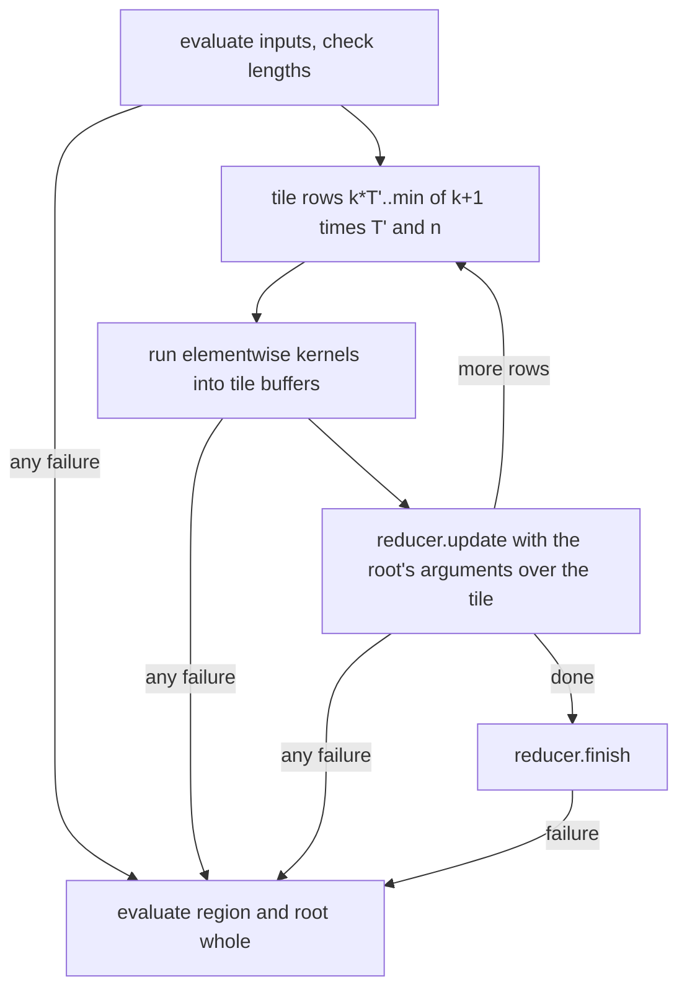

# Fused reductions over tiled regions: design

This layer addresses #30, the cost of writing an elementwise result to memory in full and reading it back in a reduction.
It is roadmap layer 6, stacked on selective predicate evaluation (`docs/superpowers/specs/2026-11-02-verkehrt-selective-predicates-design.md`), which sits on the term graph and tiled regions.
Tiled regions keep the intermediates of an elementwise chain in cache, but the region's root still writes a full output array, and a reduction above it reads that array back.
This design lets a reduction be the root of a tiled region: each tile of the elementwise chain goes straight into the reduction's accumulator, so the chain's result never exists in full.
The sections below give the evidence and the scope, the mechanism, the float rule, the error rule, observation, tests, and measurement, with every decision the issue left open marked as the designer's call.

## Evidence

ClickBench q03 is the acceptance query that motivates the layer, because q29, the other case in the issue, already runs as one reduction after the term graph (`docs/measurements/2026-11-02-term-graph.md`).
Its plan (`docs/measurements/2026-11-02-term-graph/plans-after.txt`) holds `div_const_i64 UserID 4294967296` as its own statement for `hi`, which two statements read, and `reduce_add_i64 (sub_i64 UserID (mul_i64 hi 4294967296))` for the sum of `lo`.
The `sub_i64` and `mul_i64` form a tiled region whose root writes an 8 MB array that `reduce_add_i64` reads once.
In `docs/measurements/2026-11-02-selective-predicates/stats-other-on.txt` (x86-64-v3, 2451.0 us of kernel time) `div_const_i64` takes 1081.9 us, the region root `sub_i64` 961.8 us, the inner `mul_i64` 217.6 us, and both `reduce_add_i64` calls 179.7 us.
The tiled-regions record attributes the gap between root and inner kernel to the root's full-size output, since the inner `mul_i64` fell from 728.3 to 202.3 us when it stopped allocating one (`docs/measurements/2026-11-02-tiled-regions.md`, which did not measure allocation separately).

The designer ran `examples/acceptance_stats` on this tree (x86-64-v4 intrinsics, load 1.67 to 1.78) on q03 and three probe programs over the same `UserID` column, to separate the cost of the division from the cost of a full output.
These are single runs that no record holds yet, and the measurement task repeats them as committed evidence.
q03 gave 2359.0 us, with `div_const_i64` 1034.2, `sub_i64` 927.3, `mul_i64` 203.6, and the two sums 177.5 us.
`sum(UserID - (div_const(UserID, 4294967296) * 4294967296))`, where the division is an inner region kernel, gave `div_const_i64` 639.1, `mul_i64` 93.9, root `sub_i64` 441.1, and `reduce_add_i64` 90.4 us.
`sum(div_const(UserID, 4294967296))`, a whole division, gave 765.1 us for `div_const_i64`, and `sum((UserID * 3) - UserID)` gave 273.6 us for the inner `mul_i64` and 466.6 us for the root `sub_i64`.

Two conclusions follow, both estimates from these numbers.
A region root that writes a full array costs 440 to 930 us on these rows, where an inner kernel of the same region costs 90 to 270 us, so fusing the root into the reduction should save most of the difference, about 700 us of q03's 2359 us, or 30%.
The division by 2^32 costs about 640 us even inside a region, where a multiply costs 94 us, because `DivConstBody` in `src/kernels/scalar/elementwise.rs` computes a 64 by 64 to 128 bit multiply-high per row and the divisor is not special-cased.
A `rem` primitive computes the same quotient, so `lo = rem(UserID, 2^32)` would replace `mul_i64` and `sub_i64` (about 1130 us in q03) with one more division (about 640 to 1030 us), and the estimate for `rem` alone is 5% to 20% of q03's kernel time.

TPC-H q06 is not a case for this layer, although the issue names it.
Its plan is `dot_i64 (compress_i64 l_extendedprice m) (compress_i64 l_discount m)` behind the mask chain, so the products already fuse into the sum through the `dot` pattern, and the reduction's arguments are selections, not elementwise kernels.
Reaching q06 needs a rewrite from the sum of compressed products to a masked sum, which is exact only for integers, and that is a planner change outside this layer.
Among the other acceptance plans, only reductions of class `Reduction` qualify, and every other reduction in them reads a leaf or a bound variable (`reduce_max_i64 g`, `count start`) or is a grouped `reduce_into_*` kernel of class `Whole` (`src/kernels/scalar/group.rs`), so q03 is the only acceptance query whose plan changes how it runs.

## Scope and order

Designer's call: this layer builds fused reductions in the executor and defers `rem`.
Fusion applies to every reduction over an elementwise chain, needs no new surface, and by the estimate above saves more on q03 than `rem` would.
`rem` is a surface gap (#11) that also needs a checker rule, kernels on every type, a zero-divisor error, and generator support, and after fusion it would save only the difference between one fused division and a fused `mul_i64` and `sub_i64` pair on q03.
The record of this layer states the division cost as the remaining part of q03, so that a follow-up can decide between `rem` and a cheaper division by a power of two.

## Mechanism: a reduction as the root of a tiled region

Designer's call: fusion extends tiled regions in the executor instead of adding egglog patterns.
A fused pattern per shape needs a kernel per shape, as `dot` and `sumsq` in `src/kernels/scalar/fused.rs` show, and the tiled-regions design already rejected that approach for predicates because it does not scale to arbitrary chains.
The kernel layer already has the entry point the executor needs: `Dispatch::reducer` in `src/kernels/dispatch.rs` hands out an accumulator to be fed tile by tile under the contract of `Reducer` in `src/kernels.rs`, and only tests call it today.
Every reduction kernel, including the fused `dot`, `sumsq`, `count_*` and `condsum_*` kernels, is a `Reducer`, so one mechanism covers all of them.

A fused region is a region whose root is a kernel of class `KernelClass::Reduction` with at least one argument that is a region kernel, that is an elementwise kernel with an array output that is not shared.
Its elementwise part is the union of the region kernel subtrees below the root's arguments, and it may hold a single elementwise kernel, unlike a plain region, because fusing one kernel already saves its full output.
The root's other arguments are region inputs like any other: leaves, broadcasts, shared nodes, and kernels of other classes, evaluated whole before the first tile, with the ordering rule of tiled regions unchanged.
The root itself may be shared, because `Machine::eval` consults the memo before it reaches `eval_kernel`, and a shared elementwise argument is a region input, so a reduction over it has nothing to fuse and runs as today.
The planner, the plans, and `--plan` output stay unchanged, and the executor finds fused regions while evaluating, as it finds regions today.

For each tile the executor runs the elementwise kernels as a tiled region does today, with every elementwise kernel, the topmost ones included, writing into a tile buffer, and then calls `update` on the root's accumulator with the root's arguments over the tile.
An argument that is a region kernel passes the rows of its tile buffer, an array input passes its slice, and a scalar input passes as `Arg::Splat`, as `prepare` in `src/kernels/dispatch.rs` passes it to a whole call.
After the last tile the executor calls `finish`, and the root's value is the scalar it returns.
An empty array runs one empty tile through the elementwise kernels, as a plain region does, so that each is called once as in whole evaluation, and calls no `update`, because `Dispatch::call` never updates a reduction with no rows.
Selective evaluation is unchanged inside the elementwise part: a guard fills its whole tile range, so the accumulator always receives complete tiles.

## Tile rows and float order

`Reducer` requires that every `update` except the last receive a multiple of 16 rows.
Designer's call: a fused region runs in tiles of `T'` rows, the tile row count `t` of `Tiling::Rows(t)` rounded up to a multiple of 16, or down when rounding up overflows.
The default of 16384 rows is already a multiple, so only tests and oracles that use small tiles see the rounding, and `Tiling::Rows(3)` runs fused regions in 16-row tiles over the generated arrays of up to 300 rows (`max_len` in `tests/generated/main.rs`).
Plain regions keep `t` rows, because elementwise kernels have no such requirement.

Designer's call: float reductions are fused, with no exclusion, because the reduction order of a tiled run is the order of the whole call on every variant by the kernels' contract and tests.
Float `add` and `mul` use the canonical 16-accumulator order of `CanonicalAcc` in `src/kernels/scalar/reduce.rs`, which keeps the accumulators across updates and holds back a tail of fewer than 16 rows until `finish`, so updates of multiples of 16 rows reproduce the one-shot bits.
Every ISA variant of a reduction instantiates the same body (`arch::add_reduction` compiles it per ISA in `src/kernels/x86.rs`), and the only hand-written reduction entries are the NEON float extremes of `src/kernels/aarch64/extreme.rs`, which `tests/isa_variants.rs` checks across tiles against the scalar entries, including the first NaN and ties in later tiles.
`tiled_reductions_match_whole` in `src/kernels/dispatch/tests.rs` checks every kernel of class `Reduction` fed in tiles of 64, 320, 608, and 8 rows against one update, and `isa_variants_match_scalar` in `tests/isa_variants.rs` checks every variant's tiled reduction against the scalar whole call.
The fused path stores each elementwise row through the same entry into a tile buffer before the accumulator reads it, so no operation is contracted or reordered, and the result is bit-identical to the unfused plan on every ISA and backend.

## Errors

A fused region must return the value and raise the error of whole evaluation, kind, message, and span.
Designer's call: any failure of the fused attempt discards it and evaluates the region and the root whole, the failure of an input, the length check, an allocation, an elementwise tile, an `update`, or `finish`.
The fallback extends `Machine::eval_region_whole`: it evaluates the root's arguments with the inputs the attempt already evaluated, in the order of whole evaluation, and calls the root once with `call_whole`, which raises the whole evaluation's error.
`finish` fails only for `reduce_min`, `reduce_max`, `argmin` and `argmax` on empty input, which the whole call raises too, and the fallback reruns the region on such a program, a cost that falls only on failing programs.
Kernels are pure, so the fallback yields the values and the error the whole evaluation yields, and no partial accumulator state escapes.

Three existing rules carry over without change.
Selective evaluation skips only total kernels, so a `div_const` with a zero divisor inside a fused region fails in its tile and the fallback raises its error.
Shared nodes are region inputs evaluated whole once per run, never part of the elementwise part, and a failed shared evaluation is not memoized, as today.
Demand is untouched, because the executor reaches a fused region only where it reaches the reduction today, and a reduction under an untaken `Cond` branch never runs.

## Off switch and counters

`Strategy` gains `fuse_reductions: bool`, and `Options` gains `no_reduction_fusion`, the CLI `--no-reduction-fusion`, and the acceptance bench and the stats example read `VERKEHRT_REDUCTION_FUSION=off` as they read `VERKEHRT_SELECTIVE`.
Fusion needs tiles, so `--no-tiling` turns it off as well, and `--no-fusion` keeps its meaning, planning without fused patterns.
`Interpreter::fused_reductions()` returns, per root kernel name, the fused region runs that completed tiled, summed across `run`, `eval_repl` and `Prepared::execute`, as `tiled_regions()` is.
Designer's call: a fused run also counts in `tiled_regions()`, because it is a region run that completed tiled, so the tiled-regions gate keeps counting it.

## Observation

Designer's call: statistics and trace report a fused region as the whole evaluation would, except for time, so turning fusion off changes no call count, row count, or byte count.
Every elementwise kernel records one call per fused run with the rows of its tile calls and their bytes, as in a plain region, and the topmost elementwise kernels now report write bytes of a tile buffer, which equal those of the full array they no longer write.
The root records one call with the region's row count, read bytes equal to the rows times the widths of its array arguments, which is what `Machine::observe` reports for a whole call, no write bytes, and the time of its `update` and `finish` calls plus the allocation of the tile buffers.
Trace lines keep their format and order: the region's inputs, then the elementwise kernels in post-order, then the root.
Executor tests compare the stats and trace lines of fused and unfused runs field by field apart from time.

## Tests

* **Executor unit tests.** With `Tiling::Rows(t)` for t in 1, 3, 16, 17 and 48, fused against unfused and against `Tiling::Off`: `sum` over a chain, over a single elementwise kernel, over a view starting at row 7, over an empty array, and over a length that is a multiple of the tile; `min`, `max`, `argmin` and `argmax` over chains with ties and a NaN in a later tile; `count`, `any` and `all` over a mask chain with a guard; `dot` with two region-kernel arguments and with one input argument; a root with a scalar argument; a shared root and a shared elementwise argument. Values, call counts, row counts and bytes must be equal, and `fused_reductions` must count only completed runs.
* **Float bits.** Float `sum` and product over chains of `mul` and `add` with mixed magnitudes, signed zeros and NaN, on every variant the host supports, fused with tiles of 16, 48 and 16384 rows against the unfused whole call, compared by bits.
* **Error tests.** `reduce_min` of an empty chain, `div_const` with a zero divisor inside a fused region with selective evaluation on, a kernel failing in a later tile after earlier `update` calls, an input after a region kernel that is not trivial (ordering rule), and arrays of different lengths under `dot`. Each must raise the unfused error by kind, message and span.
* **Oracle 7, fused against unfused.** On the scalar interpreter with three-row tiles, each plan run with fusion gives the output and exports of the run with `no_reduction_fusion`, and fails with the same error by kind, message and span. Oracles 1 to 6 run with fusion on, so oracle 4 compares fused runs with whole evaluation and oracle 1 compares fused runs across variants.
* **Gates for fused shapes.** The CI run requires a minimum of fused runs in oracle 7, a third of what the fixed CI seed gives, and at least one fused run per shape class that the CI seed exercises: integer sums and products, float sums and products, `min` and `max`, `argmin` and `argmax`, bool reductions (`count`, `any`, `all`, `reduce_*_bool`), bitwise folds, and the fused multi-argument kernels. Designer's call: the generator's weights stay as they are, because changing them changes every gate's baseline, and a class the CI seed does not produce is named in the record and covered by the executor unit tests.

## Measurement

The record `docs/measurements/2026-11-02-map-reduce-fusion.md` follows `docs/measurements/2026-11-02-selective-predicates.md`: criterion with the five variants, `sample_size(10)`, a 0.5 s warm-up and a 3 s measurement time, the 1-minute load at or below 4 and recorded at the start and end of every evidence file, the 10% noise band, and every number from a committed evidence file.
The before numbers come from the same build with `VERKEHRT_REDUCTION_FUSION=off`.
q03's same-code runs spread from 1.4 to 3.4 ms across the term-graph and selective records, wider than the band, so q03 runs at least three interleaved pairs, and its per-kernel statistics, which the spread does not affect as much, are the primary evidence for the estimate above.
TPC-H q06 and q01 serve as controls with no fused region, the full acceptance suites show that no query got slower beyond the band, and the `acceptance_plans` output must be unchanged.
The record commits the probe programs of "Evidence" with their statistics, states the division cost that remains in q03, and compares q03 with DuckDB (1.96 ms one thread) and corgi (1.03 ms) from `docs/measurements/2026-10-31-clickbench-now.md` and TPC-H q06 with the figures of `docs/measurements/2026-10-31-tier2.md`.

## Non-goals

* A `rem` primitive and a power-of-two path in `div_const`, which the record's numbers inform.
* Rewriting TPC-H q06's sum of compressed products into a masked sum.
* Fusing regions into selections (`compress`, `filter`), scans, or grouped `reduce_into_*` kernels.
* Skipping rows of a reduction by a mask, such as `count` over the rows a guard keeps.
* Planner or cost-model changes.

## Left to the builder

* How `Region` records a reduction root, and whether the root's accumulator call shares `Tiles::call` or has its own.
* Whether a fused region's tile buffers are allocated as today or reused across fused runs.
