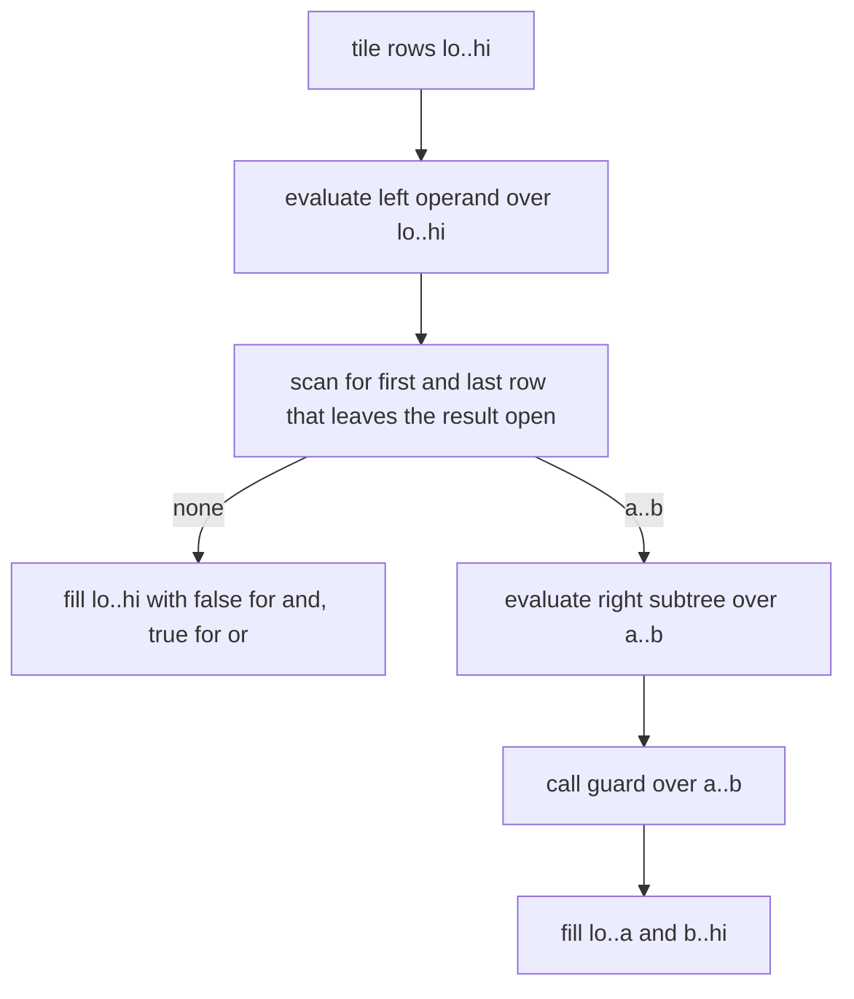

# Selective predicate evaluation: design

This layer addresses #49, the cost of the comparisons in filter predicates such as the mask chains of ClickBench q40, q41, q42 and TPC-H q06.
It is roadmap layer 5b, stacked on tiled regions (`docs/superpowers/specs/2026-11-02-verkehrt-tiled-regions-design.md`) and the term graph (`docs/superpowers/specs/2026-11-02-verkehrt-term-graph-design.md`).
Tiling keeps the 1-byte masks between kernels in cache, but every comparison still reads its 8-byte column for every row of every tile.
This design lets the right operand of an `and` run only over the rows of a tile where the left operand is true, and the right operand of an `or` only where the left operand is false, with the values and errors of whole evaluation.
The sections below give the evidence, the mechanism and why it comes before selection vectors, the eligibility and error rule, and the interactions with the existing executor, with every decision the issue left open marked as the designer's call.

## Evidence

The tiled-regions record (`docs/measurements/2026-11-02-tiled-regions.md`) found tiling saves 4% to 7% on q40, q41 and q42 and 16% on the best variant of TPC-H q06.
After tiling, `eq_i64`, `le_i64` and `and_bool` still take 1764 of 3850 us of kernel time in q40, 1638 of 3214 us in q41 and 1342.5 of 2542.7 us in q42 (16384-row tiles, `docs/measurements/2026-11-02-tiled-regions/stats.txt`), and `le_i64`, `lt_i64` and `and_bool` take 1248 of 1985 us in TPC-H q06.
The same record concludes that the column reads dominate the chain, because a comparison reads 8 bytes per row and writes 1.
How many column reads a selective scheme saves depends on how the rows that pass the first predicates are laid out, so the designer simulated two schemes over the column files of the acceptance data.
The next paragraph gives the method, and the table after it the result.

The simulation took each query's mask expression as the plan has it, with the operand order of the source, and counted the rows each comparison evaluates.
Under range narrowing (the mechanism below) the right operand of an `and` evaluates rows from the first to the last true row of the left operand within each 16384-row tile, and that of an `or` rows from the first to the last false row.
Under selection vectors the right operand evaluates exactly the rows where the left operand leaves the result open.
Every result mask equalled the whole mask, and the reduced forms of q40 and TPC-H q06 run through `verkehrt run --plan` keep the source operand order in their plans.
The simulation is the designer's analysis, not a measurement, and the measurement task checks its row counts against the statistics.

| Query | comparisons | rows evaluated, whole | range narrowing, 16384 rows | range narrowing, 1024 rows | selection vectors |
|---|---|---|---|---|---|
| q40 | 7 | 1.000 | 0.497 | 0.496 | 0.436 |
| q41 | 6 | 1.000 | 0.512 | 0.511 | 0.504 |
| q42 | 5 | 1.000 | 0.531 | 0.531 | 0.530 |
| TPC-H q06 | 5 | 1.000 | 0.998 | 0.977 | 0.400 |

Rows evaluated are a fraction of comparisons times table rows (1,000,000 for ClickBench, 1,199,969 for TPC-H).
On the ClickBench data `CounterID == 62` keeps 41.4% of the rows, and narrowing after it at 1024 rows matches the selection-vector count for the next comparison, so the kept rows form long runs and range narrowing comes within 6.1 points of the selection-vector ideal on q40 and within 1 point on q41 and q42, and the tile size barely matters.
`EventDate` passes every range test on this data, so the date comparisons decide nothing, and narrowing pays only through the comparisons after `CounterID == 62`.
The TPC-H lineitem rows that pass `l_shipdate >= 8766` are spread across the tiles, so range narrowing saves 0.2% of the comparison rows on TPC-H q06, while selection vectors would cut its comparison rows to 0.40.
If comparison time scales with the rows evaluated, narrowing saves about half the comparison time of q40, q41 and q42, roughly a fifth of their kernel time, which is an estimate the measurement must confirm.

**Outcome.** The measurement (`docs/measurements/2026-11-02-selective-predicates.md`) confirms the simulation: the mask comparisons read 0.4973, 0.5115, 0.5311 and 0.9983 of the whole-array bytes on q40, q41, q42 and TPC-H q06, against the predicted 0.497, 0.512, 0.531 and 0.998.
Comparison time fell to 0.52, 0.52 and 0.60 of the selective-off time on the three ClickBench queries for 0.50 to 0.53 of the rows, so it fell roughly in proportion to the rows evaluated (q42 by somewhat less, 0.60 for 0.53), and the comparisons with `and_bool` and `or_bool` saved 19.8%, 20.1% and 17.3% of kernel time against the estimated fifth.
The criterion means of the best variant fell to 0.83, 0.80 and 0.80 times, every one of the 15 variants of the three queries left the 10% band in three pairs of runs, and TPC-H q06 stayed inside it (1.00 to 1.05 times), at a small cost: its guards scan left operands and find almost nothing to skip, and `and_bool` rose from 252 to 330 us.
By the rule above the premise holds, so selection vectors for TPC-H q06 are the next step, with the cost of a gathered comparison on scattered rows still unmeasured.

## Mechanism: range narrowing in tiles

Designer's call: the first mechanism is range narrowing inside the tiled run, and selection vectors are deferred.
Range narrowing generalises skipping a tile whose mask is all false: an empty range skips the operand, and a range shorter than the tile skips its rows at both ends.
It calls the existing kernel entries through `Dispatch::elementwise_tile` on a contiguous sub-range of the tile, so it needs no new kernel and keeps every ISA's entries as they are.
Selection vectors need a comparison that reads gathered rows and scatters its result back into the mask, which is a new entry per comparison and ISA or a compress before each comparison, and the simulation shows they add at most 6.1 points over narrowing on ClickBench.
The next step is selection vectors for TPC-H q06 only if the measurement shows that the ClickBench comparison time falls with the rows evaluated, because that is the premise of both schemes.

A guard is a region kernel whose op is `And` or `Or` and whose output is `bool[]`, that is `and_bool` or `or_bool`, with two array arguments, of which the right is a region kernel.
For each tile, the executor evaluates the guard's left operand over the guard's row range, then finds the first and the last row of that result that leave the guard's value open, true for `and` and false for `or`.
It evaluates the right operand's subtree only over the rows between them, calls the guard over the same rows, and fills the rows outside them with false for `and` and true for `or`.
The right operand's subtree may itself contain guards, which narrow further within the range their parent gave them, so the executor evaluates a region per tile as a recursion over row ranges instead of the flat loop over kernels it runs today.
Kernels outside every guarded operand run over the whole tile as they do today.

Finding the range scans the left result forward to its first open row and backward to its last, so it reads at most two bytes more than the rows it lets the right operand skip.
When narrowing skips few rows, as the simulation predicts for TPC-H q06, the scans read few bytes, so q06 serves as the control for the remaining per-tile cost.
The fill writes one byte per skipped row of the guard's output, which is at most one eighth of the bytes a skipped comparison on an `i64` column would read.
Bool storage is 0 or 1 by the contract of `ElementwiseFn` in `src/kernels.rs`, and `false & x` is 0 and `true | x` is 1 for every such `x`, so the filled rows equal what the guard computes from any right operand.
The default tile row count stays 16384, since the simulation shows the ClickBench ranges do not depend on it.

## Eligibility and errors

Errors must stay those of whole evaluation, kind, message and span, so skipping rows must never hide an error that whole evaluation raises.
Designer's call: only kernels that cannot fail are skipped, and `KernelDef` gains a field `total` that states that a kernel's entries never fail on arguments the kernel accepts whose arrays have equal lengths.
A guard narrows only when every region kernel in its right operand's subtree is total, and otherwise it runs that subtree over its whole range.
Every `KernelDef` literal sets the field, and the elementwise helper `add_entry` passes true for the kernels it registers, so only `div_const` registers through a path that sets it false. The totality test below guards against a failing kernel registered as total.
The paragraphs below say which kernels are total today and why the rule keeps errors.

Among elementwise kernels only `div_const` and its scalar twin `div_const_*_s` can fail on accepted arguments, when the scalar divisor is zero (`DivConstBody::run` in `src/kernels/scalar/elementwise.rs`), and every other elementwise body checks only arity and argument kinds.
All elementwise kernels are registered in that file, and the ISA modules return errors only from scan and extreme kernels (`src/kernels/x86/scan.rs`, `src/kernels/aarch64/extreme.rs`).
Integer `Div` has no kernel, `Op::Div` exists only for floats (`register_float`), and casts saturate, so no elementwise kernel can fail on a row's value.
`div_const`'s failure depends on the divisor alone, but a fully skipped call would still hide it, so `div_const` is not total.
A test in the kernel layer runs every total elementwise array kernel on every variant the host supports over rows of extreme values, such as zero, the type's minimum and maximum and NaN, and requires success.
The kernels of the other classes are not elementwise and never guarded, and they set `total` to false.

The argument for identical errors has three parts.
A guard skips only total kernels, and the tiled run checks before the first tile that every array input has the same length, so a skipped kernel would not have failed in whole evaluation either.
Region inputs, including shared nodes and the kernels of other classes below the region, are evaluated before the first tile exactly as today, so narrowing never changes which inputs run or in which order, and the ordering rule of tiled regions holds unchanged.
Any failure in a tile still discards the tiled attempt and evaluates the region whole (`Machine::eval_region_whole`), which raises the error of whole evaluation, and demand is untouched because the executor reaches a region only when it reaches it today.

## Order

Designer's call: a guard's left operand decides the range of its right operand, in the order the plan gives them, and the executor does not reorder.
Choosing the most selective predicate first needs selectivity estimates that the language does not have.
In the reduced forms of q40 and TPC-H q06 the plan keeps the source order, which puts `CounterID == 62` first in q40, while in q06 the rows that pass the first predicate are spread and narrowing finds little to skip in the simulated order.
`and_bool` and `or_bool` are commutative, so egglog may extract either order (`src/plan/egglog.rs`), and the plan order can differ from the source order in other programs.
That changes only how many rows narrowing skips, never a value or an error, because narrowing skips only total kernels.
The measurement task records the `--plan` output of the four queries to show the order the measured plans have.

## Interactions

**Tiling.** Narrowing exists only in tiled runs, because it reuses the tile loop and its buffers, so `--no-tiling` turns it off as well. A whole evaluation, including the fallback after a failed tile, runs every kernel over every row.

**Shared nodes.** A shared node is a region input and is evaluated whole once per run (`Machine::region_kernel`), so it is never skipped. A shared mask can still guard as a left operand, because a region input array counts as a left operand. A shared right operand is an input, not a region kernel, so the guard does not narrow it and has nothing to skip.

**Fallback.** Narrowing adds no failure of its own. When a tile fails after earlier tiles narrowed, the attempt is discarded as today, and no partial output escapes.

**Off switch.** `Strategy` gains `selective: bool` and `Options` gains `no_selective`, the CLI gains `--no-selective`, and the acceptance bench and the stats example read `VERKEHRT_SELECTIVE=off` as they read `VERKEHRT_TILE_ROWS` and `VERKEHRT_SHARING`. The before numbers come from the same build with selective evaluation off. `--no-fusion` and `--no-sharing` keep their meanings.

**Counter.** `Interpreter::narrowed_tiles()` counts the guard evaluations, one per guard per tile, in which the right operand ran over fewer rows than the guard's range, summed over the region runs that completed tiled, across `run`, `eval_repl` and `Prepared::execute`, as `tiled_regions()` does.

## Observation

Designer's call: statistics and trace report the rows a kernel actually ran over, so the bytes of a skipped comparison do not count.
A region kernel still counts one call per region run, also when every tile skipped it, so call counts are the same with and without narrowing.
Its row count is the sum of the rows of its tile calls, its bytes are that row count times the widths of its array arguments and its output, and its time is the sum over its tile calls, with a guard's range scans and fills added to the guard's time.
`KernelStat` gains `read`, the bytes of array arguments, and the stats line becomes `stats NAME calls=C bytes=B read=R time=T`, so `acceptance_stats` shows the column bytes the comparisons read, as the issue asks.
Trace lines keep their format, and `n` becomes the rows the kernel ran over, which the `--trace` help text and `Options::trace` say.

Without narrowing, in an untiled run, or with `--no-selective`, every count is that of today plus the new `read` field.
The existing executor tests that compare the stats and trace lines of tiled and untiled runs keep doing so with selective evaluation off, and selective runs are compared on values, errors and call counts.

## Bit identity

A narrowed run yields the same bytes as a whole run on every ISA and backend.
Elementwise kernels compute each output row from the same row of their inputs, so a call over a sub-range yields that sub-range of the whole result, and the filled rows equal the guard's result by the argument in "Mechanism".
The range is computed from the left operand's bool rows, which are equal on every variant, so every variant narrows the same ranges and reports the same row counts.

## Tests

* **Executor unit tests.** With `Tiling::Rows(n)` for small `n`, selective on against off: an `and` chain whose left operand is false in whole tiles, false at both ends of a tile, and true throughout, the same for `or` with true rows, nested guards, a guard as the region root and as an inner kernel feeding `select`, a left operand that is a region input array, a right operand that is a region input, a chain over a view starting at a nonzero row, and an empty array. Values must be equal, call counts must be equal, `narrowed_tiles` must grow where a range is shorter than its tile, and the stats rows must be those the test computes.
* **Error tests.** `and(x > 5, div_const(y, z) > 0)` with every `x` at most 5 and `z` zero must fail with the whole evaluation's error, which shows that a subtree with a kernel that is not total is not skipped. A kernel failing in a later tile after earlier tiles narrowed must raise the untiled error.
* **Kernel test.** The totality test of "Eligibility and errors", and a test that the `div_const` kernels are the only elementwise kernels registered as not total.
* **Oracle 6, selective against non-selective.** On the scalar interpreter with three-row tiles, each plan run with selective evaluation gives the output and exports of the run with `no_selective`, and fails with the same error by kind, message and span. It is strict like oracles 4 and 5, because a tiled run falls back to whole evaluation on any error. Oracles 1 to 5 run with selective evaluation on, so oracle 4 compares narrowed tiled runs with whole runs too.
* **Gate.** The CI run requires a minimum of `narrowed_tiles` in oracle 6, a third of what the fixed CI seed gives, so the oracle cannot pass by never narrowing.

## Measurement

The record `docs/measurements/2026-11-02-selective-predicates.md` follows `docs/measurements/2026-11-02-tiled-regions.md`: criterion with the five variants, `sample_size(10)`, a 0.5 s warm-up and a 3 s measurement time, the 1-minute load at or below 4 and recorded at the start and end of every evidence file, the 10% noise band, and every number from a committed evidence file.
The before numbers come from the same build with `VERKEHRT_SELECTIVE=off`, so only selective evaluation differs.
It covers q40, q41, q42 and TPC-H q06 with per-kernel statistics showing the `read` bytes of the comparisons, checks the rows the comparisons evaluate against the simulation in "Evidence", and runs the full acceptance suites to show no query got slower beyond the noise band.
It states whether comparison time fell with the rows evaluated, which decides the next step in "Mechanism", and compares with DuckDB and corgi from the existing reference figures.

## Non-goals

* Selection vectors, the next step if the measurement supports it.
* Reordering predicates by estimated selectivity.
* Narrowing the branches of an elementwise `select`, or fusing the mask into `compress` or `sum`, which is #30.
* Narrowing in untiled runs.

## Left to the builder

* How the per-tile recursion is structured, whether a guarded subtree writes its tile buffers from row 0 or from the range's offset, and whether the range scan works on bytes or on 8-byte words.
* How guards and the totality of their right subtrees are recorded in `Region`, computed once per region run and not per tile.
