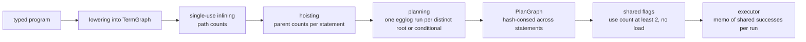

# Term graph and shared evaluation: Design

This layer addresses #39, the exponential growth of lowered terms, and the cross-statement sharing that ClickBench q29 needs.
It is roadmap layer 5, stacked on tiled regions (`docs/superpowers/specs/2026-11-02-verkehrt-tiled-regions-design.md`).
Lowering builds every statement's term as a tree, so a binding read twice and nested `d` levels deep yields `2^d` nodes before hoisting recovers the sharing, and the planner and executor never see that two statements compute the same value.
This design replaces the trees with hash-consed graphs from lowering through execution, and lets the executor compute each repeated pure plan subtree of a program once.
The sections below give the evidence, the two graphs, the shared evaluation, the tests, and the measurement, with every decision the issue left open marked as the designer's call.

## Evidence

The generated-program record (`docs/measurements/2026-11-01-generated-programs.md`, section "Exponential term growth in lowering") measured a function called as `f(f(...f(a)))` whose parameter is read four times: 0.52 s and 33 MB at depth 5, 4.84 s and 1.8 GB at depth 7.
The same record and the comment on #39 measured slow planning when a statement repeats subterms inside lazy branches: a reduced form costs 0.57 to 1.42 s for 1 to 4 nested lazy ifs, and one generated statement took 7.5 s.
The cause of both is in `src/lower.rs` and `src/plan/egglog.rs`: `Lowerer::expr` clones the bound `Term` on every read of a block let or parameter, and `substitute`, `count_ops`, `Hoister::go`, and `emit_node` recurse over the tree without memoization.
The generator works around it with `MAX_SHARE_DEPTH = 3` in `tests/generated/gen.rs`, which replaced statements in 101 of 6000 programs at seed 800000 according to the same record.
These costs are in compilation, and the next paragraph turns to the cost in execution.

q29 is ninety exports `sum(ResolutionWidth + k)`, and `docs/measurements/2026-11-01-integer-rewrites.md` shows that after the integer sum rewrites every plan contains the same `(reduce_add_i64 ResolutionWidth)`.
Its `stats.txt` attributes 8184.5 us of 8208.5 us of kernel time, 99.7%, to those ninety identical passes, and 89 plans also contain the same `(length_i64 ResolutionWidth)`.
The rewrite runs inside egglog, after lowering, so no lowering-time sharing can see the repeated reduction.
A scan of that record's `query-plans.txt` for parenthesized kernel subterms that occur more than once in one query finds only q29, so the other acceptance queries are expected to stay unchanged.
The record estimated one pass at about 0.09 ms, which puts the roadmap's goal of q29 below 1 ms in reach.

The sum rewrites in `src/plan/egglog.rs` add a third case: their right-hand side reads `?x` twice, once under the sum and once under `length`, so a plan evaluates a compound `x` twice.
The comment on `sum_rules` states this, and the `Plain` guard keeps a conditional out of `x` for that reason.
Shared evaluation removes the second evaluation without changing the rewrite.
This is a side effect of the design and not a goal the measurement tracks.

## Goals

* **Linear compilation in repeated reads.** Lowering, hoisting, single-use inlining, egglog emission, and plan construction run in time linear in the number of distinct nodes, so a value read many times costs one node.
* **One egglog fact per distinct node**, also inside the branches of lazy conditionals, and one planning run per distinct conditional.
* **Cross-statement sharing.** A pure plan subtree that occurs more than once in a program is computed at most once per execution.
* **Unchanged semantics.** Values, errors (kind, message, span), output order, demand, and lazy branches are exactly those of the unshared execution, on every ISA, backend, plan, and tiling.
* **Unchanged plans.** Every statement plans to the kernels it plans to today, and `--plan` prints the same text, except where a conditional repeats inside one emitted term (see "Planning over the graph").

## Pipeline

## The term graph

`Lowered` gains a `TermGraph`, an arena of nodes addressed by `TermId(u32)`.
A node is its kind and its type: `Op(Op, Vec<TermId>)`, `Leaf(LeafId)`, `Bcast(TermId)`, or `Cond(TermId, TermId, TermId)`, with the meaning the `TermKind` variants have today.
The graph interns nodes in a hash map keyed on the kind and the type, so building a node whose children are already interned returns the existing id, and structural equality becomes id equality.
`LStmt` holds a `TermId` instead of a `Term`, `Lowerer::env` and `Lowerer::lifted` hold ids, and a read of a bound variable copies an id.
The `Term` tree type goes away, because no consumer needs a tree once the planner reads the graph.

Designer's call: nodes carry no span.
The only reader of a term's span today is the planner's internal-error path at `src/plan.rs` (`Some(term.span)`), because runtime errors carry the span of their statement (`Machine::span` in `src/exec.rs`) and lowering's type errors take the span of the typed expression as an argument (`no_kernel`, `array_lit`).
With interning, a node's span would be the span of whichever statement built it first, so a planner error in a later statement would point at an earlier one.
The planner therefore takes the statement span as an argument, and the "first occurrence wins" rule of the issue has nothing left to decide.
This deviates from the issue's proposal, which kept a span on the node and outside the key.

Designer's call: the leaf table is indexed by hash maps, one from `VarId` to `LeafId` and one from a scalar or string constant to `LeafId`, keyed as `same_const` compares today (type and display text for scalars, the string for strings).
`Leaves::var` and `Leaves::constant` scan the whole table today, which is quadratic in the number of leaves.
Ids are still assigned in order of first request, so every `LeafId` stays what it is today.
Array constants stay unshared, each literal its own leaf, as the comment in `Leaves::constant` requires.

The higher-order helpers in `src/lower/higher.rs` build terms through the `Build` trait, whose `ty` takes no receiver and whose `apply` borrows `self` immutably.
Interning needs the graph, so `ty` takes `&self` and `apply` and `apply_exact` take `&mut self`.
The checker's `Lifting` in `src/check/lifting.rs` implements the trait too and adapts its signatures without changing behavior.
This is the only change outside lowering, planning, and execution.

### Single-use inlining

`inline_single_use` counts the uses of each let as occurrences of its variable leaf in the statement trees, and inlines a compound let with exactly one.
The graph keeps that rule by counting paths: a node's use count is the sum over its parent edges of the parent's count, with each statement root counting one, computed in topological order and saturated at 2.
Path counts in the graph equal occurrence counts in the tree, so the set of inlined lets does not change.
`substitute` becomes a rebuild of the statement's graph with a memo from old id to new id, interning as it goes, so it visits each node of a statement once.
Lets used only inside a branch still move into the branch, because substitution enters branches as it does today.

### Hoisting

Hoisting stays per statement, with the rule of `count_ops`: a compound node that is reached at least twice outside the branches of conditionals becomes a temporary bound before the statement.
On the graph, the count of a node is the number of edges into it from the distinct `Op` and `Cond` nodes reachable from the statement root, where a `Cond` contributes only the edge to its condition.
A `Bcast` node is transparent and passes its own count on to its operand, because `count_ops` descends into a broadcast at every occurrence and never counts the broadcast itself.
Branches are rewritten as they are today, which is not at all, so nothing inside a lazy branch moves into code that always runs.
The rewrite visits nodes in the order of `Hoister::go`, children left to right before the parent's bind, so temporaries keep their numbers and binds keep their order.

Designer's call: hoisting does not reach across statements.
A temporary shared by two statements would carry the span of the first, so an error demanded by the second would report a statement that is not on its chain, which the span rule of errors as data forbids (`docs/superpowers/specs/2026-11-02-verkehrt-errors-as-data-design.md`, goal "Errors as data").
A temporary is also a leaf to the planner and would cut fusion at the statement boundary, and q29's repeated reduction does not exist before egglog in any case.
Cross-statement sharing is therefore the executor's job, described below.
The graph itself is shared by all statements of a program, which costs nothing and lets the planner reuse a plan for a repeated root.

## Planning over the graph

`Planner::plan` takes the term graph, a root id, the statement span, and a per-program planning context that holds the plan graph and a memo.
`egglog::emit` writes one `let` and its `Arr` and `Plain` facts per distinct node reachable from the root, with a memo from `TermId` to the emitted name, and it collects each distinct conditional once as a hole.
Repeated op, leaf, and broadcast nodes already land in one e-class today, because egglog hash-conses equal constructor applications, so deduplicating their facts only drops redundant commands.
Conditionals differ: today each occurrence is its own hole, a distinct e-class, and now a conditional repeated inside an emitted term is one hole, planned once.
Hoisting already merges such repeats outside branches, so this happens only inside the branch of another conditional.
Fused patterns that read a variable twice, such as `sumsq` and `filter_<cmp>`, may then match across the repeats, so such a plan can change, for example from `dot_f64` to `sumsq_f64`, while its value stays the same.
The planner test `repeated_conditional_in_a_branch_is_one_hole` pins two such plans, and no expectation file or acceptance plan contains the shape.
Each hole is planned once, and the memo maps a planned `TermId` to its `PlanId` and the sum rewrites that fired while planning it.

Designer's call: the planning memo spans the whole program, not one statement.
A root or a conditional plans the same way wherever it occurs, because `plan_into` reads nothing but the subgraph and egglog runs deterministically on the same commands.
A repeated statement root or a conditional repeated across statements then costs one egglog run.
`plan_with_sum_rewrites` returns the memoized set for a memo hit, so the test hook reports what it reports today.

Designer's call: extraction walks egglog's `TermDag` instead of printing it and parsing the text back.
`CommandOutput::ExtractBest` carries a hash-consed `TermDag` and a root `TermId` (`egglog-3.0.0/src/lib.rs`, `src/termdag.rs`), and `TermDag::to_string` expands it into a tree, which is exponential in the same programs.
The walk maps each DAG node once into the plan graph, `Leaf` and `Hole` from their integer literal, `Bcast` from its child, and a `K_` constructor to its kernel.
`src/plan/sexpr.rs` stays for the fused kernel patterns.

### The plan graph

`PlanNode` keeps its four variants but its children become `PlanId`s into a `PlanGraph`, which interns nodes across all statements of a program as the term graph does.
`exec::Plan` holds the lowered program, the plan graph, one root `PlanId` per statement, and the shared flags described below.
`render` keeps its text format and expands the graph into a tree as it prints, so `--plan` output does not change.
Designer's call: that expansion is exponential on the adversarial programs, and `--plan` is a diagnostic that the tests run only on small programs, so it stays a plain recursion.

Designer's call: the plan becomes a graph rather than a tree with sharing annotations.
Repeats inside lazy branches survive hoisting by design, so a function such as `fn f(q) { if s > 0.0 { q + q } else { q } }` called as `f(f(f(a)))` has a linear term graph but an exponential plan tree.
A tree would also need a structural key for each shared subtree, which costs time proportional to the subtree's size, the cost #39 removes from lowering.
The executor and the tiled regions therefore read `PlanId`s, which is a mechanical change to `Machine::eval`, `collect`, `eval_region`, `eval_region_whole`, and `Region::inputs`.

## Shared evaluation

A plan node is shared when it is a `Kernel` node, its subgraph contains no `load_*` kernel, and it has at least two uses, where a use is an edge from a parent in the plan graph or a statement root.
The executor keeps a memo of shared node values for one `run_plan` call.
Evaluating a shared node returns the memoized value if there is one, and otherwise evaluates the node and stores the value when the evaluation succeeds.
A failed evaluation is never stored.

The memo changes nothing observable except kernel calls, by the following argument.
Kernels are deterministic and values are immutable (`Value` is `Arc`-backed, and the only `Arc::get_mut` in `src/value.rs` is on tile buffers), so a memoized value equals, byte for byte, the value a second evaluation would produce on the same ISA and backend.
A `Leaf::Var` cannot change during a run, because each variable is created once by `Globals::fresh_var` (`src/check.rs`) and bound by at most one `Bind` per program, and the environment swap of failed earlier bindings in `Interpreter::eval` happens before `run_plan`.
The memo is filled only by evaluations that the unshared run performs too, so nothing runs that would not run without it, and a value first computed in a taken branch may serve a later statement because the unshared run computes it as well.
Skipping a repeated evaluation that would succeed leaves the first failing evaluation, and with it the reported error, where it is in the unshared run.

**Errors.** A failure is recomputed by each statement that needs the node, so the error carries the span of the statement that computes it, as errors as data requires.
Storing failures would report the first statement's span in a later one, which is the case the brief warned about.
The cost falls only on failing programs, as the fallback of tiled regions does.
Usage and I/O errors fail the run at once and never reach the memo.

**Loads.** Designer's call: subgraphs with a `load_*` kernel are not shared.
A load reads a file, so two loads of one path could differ if the file changes, and sharing would merge them.
Keeping them separate preserves today's behavior exactly, and the acceptance programs take their columns as inputs, so nothing measured depends on it.

**Lazy branches.** The memo is filled on evaluation, so a shared node inside an untaken branch is never computed, and a `Cond` node is never shared itself, only the kernels below it.
This covers repeats inside branches too, such as `sum(x + x) + sum(x + x)` in a taken branch (`repeated_subterm_in_branch_is_not_hoisted` in `src/lower/testdata/conditionals.dd`), which runs once.

**Tiled regions.** A shared node is a region input, never a region kernel, so it runs through `eval` and the memo, and the region tiles the kernels above it.
Designer's call: a shared elementwise kernel is materialized once rather than recomputed inside each region that reads it, because that keeps one evaluation per execution as the goal states, and repeats within one statement are already materialized as hoisted temporaries today.
The values of tiled and untiled runs stay equal, because tiling never changes a value.

**REPL and prepared programs.** The memo lives for one `run_plan` call, which is one REPL input or one `Prepared::execute`.
Designer's call: nothing is shared across REPL inputs, because a `LeafId` and a `PlanId` index tables of one compiled program and mean nothing in the next.
Each `Prepared::execute` starts with an empty memo, so the acceptance bench, which times `execute` only (`benches/acceptance.rs`), measures one shared evaluation per run.

**Memory.** Designer's call: memoized values live until the end of the run.
The environment holds every binding and hoisted temporary until the end of the run too, so the memo adds at most the values that hoisting would have bound if the repeats were in one statement.
Freeing a value after its last use needs a use count that untaken branches never decrement, which is a refinement for later.

**Observation and options.** A memo hit calls no kernel, so it adds no statistics and no trace line.
`Interpreter::shared_hits()` counts memo hits as `tiled_regions()` counts tiled runs, across `run`, `eval_repl`, and `Prepared::execute`.
`Options::no_sharing` and the CLI flag `--no-sharing` turn shared evaluation off, the acceptance bench and the stats example read `VERKEHRT_SHARING=off` as they read `VERKEHRT_TILE_ROWS`, and `--no-fusion` and `--no-tiling` keep their meanings.
The `--trace` help text says that a value computed once and read again prints one line.

## Generator and tests

* **Cap removal.** `MAX_SHARE_DEPTH`, the replacement of over-deep statements by leaves, and the feature "statement over the sharing depth cap" go away. `Gen::share_depth` stays as a measure and feeds a feature "sharing depth over 3".
* **Deep-sharing gate.** Designer's call: the CI run requires a minimum number of programs with sharing depth over 3, set at a third of what the fixed CI seed produces, as `MIN_TILED_REGIONS` is set. That proves the generator now produces the shapes the cap removed.
* **Oracle 5, shared against unshared.** On the scalar interpreter, each plan run with sharing on gives the output and exports of the run with `no_sharing`, and fails with the same error by kind, message, and span. It is strict like oracle 4, because the argument above says the memo changes nothing.
* **Shared-hit gate.** The CI run requires a minimum of memo hits in oracle 5, again a third of what the fixed seed gives, so the oracle cannot pass by never sharing.
* **Linear-size unit tests.** Deterministic tests build the three adversarial shapes at depths where a tree would be enormous: a block-let chain `let a1 = a0 + a0; let a2 = a1 + a1; ...` at depth 64, the function form `f(f(...f(a)))` at depth 32, and the lazy-branch form of the #39 comment with 16 nested ifs. They assert node counts of the term graph, the emitted `let` commands, the planned holes, and the plan graph that grow linearly in the depth. A regression fails the assertion in milliseconds instead of exhausting the CI budget.
* **Executor unit tests.** q29's shape with a handful of sums plans to one shared reduction, runs it once (stats), and counts the hits. Two statements sharing a failing subtree report each statement's own span. A shared node only in an untaken branch never runs. A shared elementwise kernel feeding two regions runs once and both regions still tile. Two REPL inputs with the same expression each compute it.

Designer's call: hash-consing removes the growth from repeated reads of one value, not from call trees whose calls get distinct arguments, such as `g(x) = f(x) + f(x + 1)` nested `d` deep.
Those terms have `2^d` distinct nodes, because inlining duplicates genuinely different work, and the generator's existing depth limits (`VERKEHRT_GEN_DEPTH`, `VERKEHRT_GEN_FNS`) bound them as they do today.
The debug CI run must stay well under 30 s after the cap goes, and it took 13.7 s according to the generated-program record.
If removing the cap pushes it past about 20 s, the task stops and reports rather than tuning the cap back in.

## Expectation changes and review

Term spans are not observable today (see "The term graph"), runtime errors carry statement spans, and hoisting and inlining keep their rules and order, so no span in any expectation file is expected to change.
The tasks up to the plan graph must leave `src/*/testdata/*.dd`, `tests/programs/*.dd`, `tests/cli.rs`, and the `acceptance_plans` output byte for byte unchanged.
The one accepted plan change, a conditional repeated inside an emitted term planning once (see "Planning over the graph"), touches none of them.
A diff there is a finding: the task stops, and its report names each changed expectation and the mechanism that changed it, for the user to accept or reject.
Shared evaluation may change only kernel-call counts in statistics and trace expectations, such as `stats_total_per_kernel` in `tests/programs.rs`, whose two `print(sum(x))` statements become one call. That test runs with `no_sharing` to keep testing totals, and a sibling asserts one call with sharing.

## Measurement

The record `docs/measurements/2026-11-02-term-graph.md` follows `docs/measurements/2026-11-02-tiled-regions.md`: criterion with the five variants, `sample_size(10)`, a 0.5 s warm-up and a 3 s measurement time, the 1-minute load at or below 4 and recorded at the start and end of every evidence file, the 10% noise band, and every number from a committed evidence file.
The before numbers come from the same build with `VERKEHRT_SHARING=off`, so only shared evaluation differs, as the tiled-regions record did with `VERKEHRT_TILE_ROWS=off`.
It covers q29 in two runs, with per-kernel stats showing one `reduce_add_i64` call, and the full acceptance suites with sharing on and off, naming every query and variant that moved beyond the noise band.
It includes `acceptance_plans` output from before the term graph and after, which must be identical, and the DuckDB (7.24 ms) and corgi (33.14 ms) q29 figures reused from `docs/measurements/2026-10-31-clickbench-now.md`.
The compile-time side is shown by the generator's function form at depths 5 and 7, timed in the release CLI against the 0.52 s and 4.84 s of the generated-program record.

## Non-goals

* Weighing shared nodes in extraction, which still charges a shared node once per use. That is #24.
* Fusing maps into reductions, which is #30 and reworks the same code next.
* Sharing across REPL inputs or across `Prepared::execute` calls.
* Freeing memoized values before the end of a run.
* Sharing between kernels that read the same column through different operations, such as q40's `EventDate` comparisons, which compute different values.

## Left to the builder

* The arena layout, the hash map types, and whether the interning key stores the kind by value or by reference.
* The names of the planning context and its fields, and whether shared flags are a `Vec<bool>` or a bit set.
* The memo's container, indexed by `PlanId` or a hash map, guided by the cost on programs without sharing, which must stay inside the noise band.
* The exact gate thresholds, taken from the fixed CI seed as stated above.
